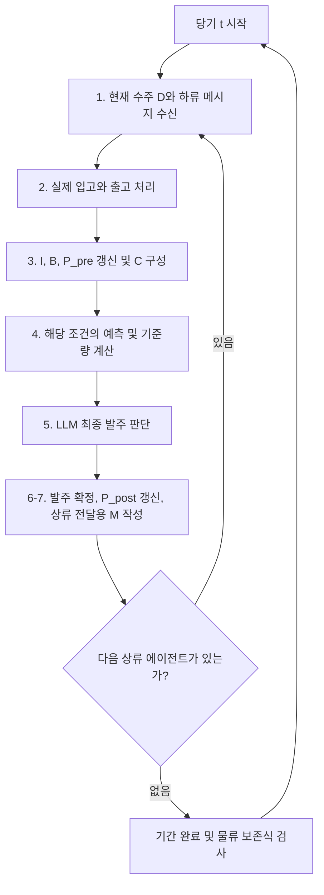

# SCM 시스템과 코드 구성 안내

이 문서는 공동연구자가 외부 Word 파일 없이 현재 구현의 물류 규칙, LLM 의사결정, 정보 범위와 결과를 확인할 수 있도록 작성했습니다. 설명의 기준은 저장소의 현재 Python 코드입니다. 실행 명령과 API 설정은 [README](../README.md)에서도 확인할 수 있습니다.

현재 실험은 **C 4수준 × M 5수준 × T 5수준의 100조합 + 별도 A + D_cost + D_bullwhip = 103조건**입니다. 조건을 등록하는 것과 실행하는 것은 별개입니다. 사용자가 실행할 조건과 수요 seed를 명시해야 하며, 저장소를 실행했다고 103조건이 자동으로 시작되지 않습니다.

## 1. 폴더와 코드의 역할

| 파일·폴더 | 역할 | 먼저 확인할 대상 |
|---|---|---|
| [scm/config.py](../scm/config.py) | 물류, 수요, 비용, API의 기본 설정 | 준비 30기, 평가 100기, 리드타임 2, SES 가중치, 주문 상한 |
| [scm/registry.py](../scm/registry.py) | 실제 조건 등록과 목적 선택 검증 | `registry()`, `get_condition()`, A와 C0M0T0의 분리 |
| [configs/registered_conditions.json](../configs/registered_conditions.json) | 등록 조건을 사람이 확인하기 위한 목록 | 실행 기준은 이 파일을 읽는 방식이 아니라 `registry.py`임 |
| [scm/engine.py](../scm/engine.py) | 공급망 상태, 입출고, 재고·백로그·미입고 발주잔량 갱신 | `SupplyChain`, `begin_agent()`, `finish_agent()`, `make_warmup()` |
| [scm/forecasting.py](../scm/forecasting.py) | 세 예측법, OUT 계산, 공통 수량 보정 | `forecast()`, `order_up_to()`, `normalize_order()` |
| [scm/harness.py](../scm/harness.py) | C 구성, T 수행, 최종 주문, M 작성, 단계별 대체 처리 | `build_C()`, `Harness.decide()`, 메시지 스키마·검증 |
| [scm/prompts.py](../scm/prompts.py) | 역할별 영어 프롬프트와 예측 공식 | 직접 주문 A, 일반 주문, D 참고량의 구별; M2/M3 지시 |
| [scm/provider.py](../scm/provider.py) | OpenRouter HTTP 요청, JSON 검증, 재시도, API 예산·기록 | `OpenRouterProvider`, `MockProvider`, `Budget` |
| [scm/runner.py](../scm/runner.py) | 조건·seed별 실행, 준비기간 복제, 체크포인트와 결과 저장 | `run_batch()`, `run_episode()`, `WarmupCache` |
| [scm/metrics.py](../scm/metrics.py) | 완주 결과의 성과·사용량·오류 집계 | `summarize()` |
| [scm/analysis.py](../scm/analysis.py) | 과거에 고정한 4조건×8 seed 예비실험 전용 분석 | 새로운 전체 조합 분석기로 사용하면 안 됨 |
| [scm/__main__.py](../scm/__main__.py) | `python -m scm` 명령행 인터페이스 | `list`, `run`, `analyze` |
| [run.py](../run.py) | 같은 명령행 실행으로 연결하는 진입점 | 일반적으로 `python -m scm` 사용 |
| [Run-Experiment.ps1](../Run-Experiment.ps1) | Windows 실행 편의 스크립트 | 조건·seed·목적·예산을 인자로 전달 |
| [status.py](../status.py) | 완료된 에피소드의 결과 조회 | 아직 완료되지 않은 실행의 진행률·비용을 합산하지 않음 |
| [tests](../tests) | 물류 보존식, 정보 범위, 실패 처리, 지표, 실행·저장 검사 | `python -m unittest discover -s tests -v` |
| [docs](.) | 현재 설명, 설계 기록, 검증·과거 예비실험 이력 | 각 문서의 현재/과거 적용 범위를 확인 |
| `results/` | 실행하면서 로컬에 생성되는 원자료·응답·체크포인트 | 기본적으로 Git에서 제외되며 복제한 저장소에 없을 수 있음 |

실행 코드의 설정을 바꾸면 새로운 실험 버전이 됩니다. 이미 실행한 결과 폴더에 변경된 코드를 이어 붙이지 말고 새 출력 폴더를 사용해야 합니다. `scm/*.py` 내용의 해시와 설정을 실행 결과에 저장하여 서로 다른 구현의 결과가 섞이지 않게 검사합니다.

## 2. 네 단계와 기호

코드의 에이전트 인덱스는 다음과 같이 **0부터** 시작합니다.

| `i` | 코드 역할 | 한국어 역할 | 수주 D의 출처 |
|---|---|---|---|
| 0 | `retailer` | 소매상 | 외부 고객 수요 |
| 1 | `wholesaler` | 도매상 | 같은 기 소매상의 확정 발주 |
| 2 | `distributor` | 유통업자 | 같은 기 도매상의 확정 발주 |
| 3 | `factory` | 공장 | 같은 기 유통업자의 확정 발주 |

주문·추가 메시지는 소매상에서 공장 방향으로 전달되고, 실제 상품은 반대 방향으로 이동합니다. `i-1`은 하류 에이전트, `i+1`은 상류 에이전트입니다. `t-1`은 **같은 에이전트의 직전 기간**이며 이전 에이전트를 뜻하지 않습니다.

| 기호·필드 | 의미와 측정 시점 |
|---|---|
| `D[i,t]` | 당기에 받은 신규 주문. 소매상에게는 고객 수요 |
| `A[i,t]` | 당기에 실제로 도착한 상품 수량. 비교조건 A와 다른 기호 |
| `X[i,t]` | 당기에 하류로 실제 출고한 수량 |
| `I[i,t]` | 당기 입고·출고 처리 후 보유 재고 |
| `B[i,t]` | 당기 입고·출고 처리 후 아직 충족하지 못한 수주잔량(백로그) |
| `P_pre[i,t]` | 당기 실제 입고를 차감하고, 자기 당기 발주는 아직 더하지 않은 미입고 발주잔량 |
| `P_post[i,t]` | 자기 당기 최종 발주까지 더한 미입고 발주잔량 |
| `Q_base[i,t]` | LLM 최종 판단에 제공한 기준 주문량 또는 D 조건의 참고량. 별도 A에는 없음 |
| `Q_final[i,t]` | 실제 실행한 최종 발주량 |

`P`는 단순히 운송 중인 상품만 뜻하지 않습니다. 이미 발주했지만 상류가 아직 출고하지 못한 주문도 포함하는 **미입고 발주잔량**입니다. 실제 도착 예정표 `arrivals`는 별도로 관리합니다.

매 기간 말에는 다음 관계를 검사합니다.

```text
하류 에이전트의 P_post
  = 그 에이전트를 향해 운송 중인 물량의 합
  + 바로 위 상류 에이전트가 아직 출고하지 못한 backlog
```

공장 외부 공급원은 무제한 생산·공급이 가능하다고 가정하므로 공장의 P에는 외부 공급원의 backlog가 붙지 않습니다.

## 3. 한 기간의 실행 순서

한 기간에 네 에이전트가 먼저 모두 판단하고 나중에 모두 물류를 처리하는 구조가 아닙니다. **소매상의 전체 처리 → 도매상의 전체 처리 → 유통업자의 전체 처리 → 공장의 전체 처리**를 완료한 다음 다음 기간으로 넘어갑니다.



별도 A에서는 4단계의 예측·기준량 계산을 건너뜁니다. D_cost와 D_bullwhip은 일반 CMT의 OUT 대신 각각의 직접 참고량을 계산합니다. 이는 같은 물류 흐름 안에서 결정 지원 방식만 달라지는 것입니다.

### (1) 수주와 추가 메시지 수신

소매상은 미리 생성한 당기 외부 고객 수요를 받습니다. 나머지 에이전트는 이미 당기 판단을 마친 바로 아래 에이전트의 최종 발주를 받습니다.

```text
D[0,t] = 외부 고객 수요[t]
D[i,t] = Q_final[i-1,t]                  (i = 1, 2, 3)
```

실제 주문 D는 모든 M 수준에서 전달됩니다. M0는 주문 거래 자체를 없애는 조건이 아니라 **추가 메시지만 없는 조건**입니다. 소매상에게는 하류 LLM 에이전트가 없으므로 수신 M이 없습니다.

### (2) 실제 입고·출고

입고 A는 실제 도착 예정표에서 가져옵니다. 직전 기간 말의 재고와 당기 입고를 합쳐 기존 백로그와 당기 신규 수주를 처리합니다.

```text
X[i,t] = min(I[i,t-1] + A[i,t], B[i,t-1] + D[i,t])
```

기존 백로그부터 먼저 충족합니다. 따라서 소매상의 당기 신규 수요 중 즉시 충족량은 다음과 같습니다.

```text
immediate_filled[i,t] = min(D[i,t], max(0, X[i,t] - B[i,t-1]))
```

상류가 t기에 실제 출고한 X는 하류에 t+2기에 도착합니다. **발주한 날부터 무조건 2기 뒤 입고되는 것은 아닙니다.** 상류 재고가 부족하면 출고 자체가 늦어질 수 있습니다. 공장에 한해서 외부 공급원에 발주한 수량이 t+2기에 입고되도록 등록합니다.

### (3) 주문 판단에 사용할 상태 갱신

```text
I[i,t]     = I[i,t-1] + A[i,t] - X[i,t]
B[i,t]     = B[i,t-1] + D[i,t] - X[i,t]
P_pre[i,t] = P_post[i,t-1] - A[i,t]
```

여기에서 만든 자신의 상태와 허용된 과거 이력이 C에 들어갑니다. LLM의 최종 주문은 이미 끝난 당기 출고를 다시 바꾸지 않습니다.

### (4) T 수행과 기준 주문량 계산

일반 CMT 조건은 자신의 최신 수주 30개 `D[i,t-29] ... D[i,t]`로 다음 두 기간의 수주를 예측합니다. **당기 수주가 포함**되며, 예측 대상은 자신의 `D[i,t+1]`, `D[i,t+2]`입니다. 발주 Q나 미래 고객 수요가 모든 단계의 공통 예측 대상인 것은 아닙니다.

예측 뒤 환경 코드가 다음 OUT(order-up-to) 식을 계산합니다.

```text
IP = I[i,t] + P_pre[i,t] - B[i,t]
S = forecast_h1 + forecast_h2 + safety_stock
Q_base_raw = max(0, S - IP)
Q_base = 공통 수량 보정(Q_base_raw)
```

안전재고 기본값은 0입니다. Q_base는 이미 자신의 재고·백로그·파이프라인을 반영한 **참고 발주량**입니다. 최종 LLM이 이 상태량을 다시 기계적으로 차감하지 않도록 프롬프트에 설명합니다.

### (5) LLM의 최종 주문 판단

일반 CMT와 D 조건에서 최종 호출에 전달하는 JSON 자료는 다음 세 가지입니다.

```json
{"C": "자신의 허용된 상태·이력·통계", "M": "하류 추가정보 또는 null", "Q_base": "계산된 참고량"}
```

실제 자료형은 각 정의에 맞는 객체·문자열·숫자입니다. 위 예시는 항목의 의미를 설명하기 위한 표시입니다. LLM은 세 정보를 종합하여 기준 주문량을 유지하거나 변경할 수 있습니다. 출력의 `order_quantity`를 환경이 공통 보정한 값이 Q_final입니다. 짧은 `rationale`도 기록하지만, 이것이 상류 메시지로 자동 전달되는 것은 아닙니다.

별도 A의 최종 입력은 정확히 `C`와 당기 `D`입니다. C0.current.D와 별도 D는 같은 신규 수주이므로 중복해서 더하지 않도록 설명합니다.

### (6)·(7) 발주 확정, 파이프라인 갱신과 상류 전달

```text
P_post[i,t] = P_pre[i,t] + Q_final[i,t]
D[i+1,t] = Q_final[i,t]                  (다음 상류 에이전트가 있을 때)
```

코드에서는 `finish_agent()`가 Q_final과 P_post를 한 번 확정합니다. **그 뒤** M1을 환경이 만들거나 M2/M3/M4를 LLM이 작성합니다. 이렇게 해야 송신 메시지의 P_post가 당기 확정 주문을 포함한 실제 값이 됩니다. 다음 상류 에이전트는 그 확정 주문과 메시지를 함께 받은 뒤 자신의 (1)~(7)을 시작합니다.

M 작성이 실패했다고 이미 확정한 주문을 다시 판단하지 않습니다. 메시지 단계만 재시도하고, 최종 실패 시 추가 메시지 없이 확정 주문을 전달합니다. 공장에는 별도 상류 LLM 에이전트가 없으므로 송신 메시지 호출이 없습니다.

## 4. 초기화, 준비기간과 수요 seed

기본 시간축은 다음과 같습니다.

| 시간 | 운영 |
|---|---|
| 가상 과거 -29~0기 | 각 에이전트의 수주 이력 30개를 모두 10으로 채움. 실제 물류를 30회 실행한 것이 아님 |
| 0기 초기 상태 | 각 에이전트 I=0, B=0, P=20. 1기와 2기에 10씩 도착하도록 지정 |
| 실제 1~30기 | 공통 준비기간. LR30 + OUT 규칙으로 운영, LLM/API 사용 없음 |
| 실제 31~130기 | 조건별 평가기간. 준비기간 종료 상태와 이력을 이어받아 100기 운영 |

준비기간에도 당기 수주를 먼저 이력에 추가한 뒤 최신 30개를 사용합니다. 예를 들어 1기의 예측 입력은 가상 관측 29개와 실제 1기 수주 1개입니다. 30기에는 최신 30개 모두 실제 수주입니다.

외부 고객 수요는 전용 난수 생성기 `random.Random(seed)`의 정규분포 N(10, 3²) 추출값을 비음수 정수로 보정하여 한 에피소드 길이만큼 미리 만듭니다. 따라서 **보정 전 연속 추출값**의 평균·표준편차 설정이 10과 3이며, 실제 정수 수요의 표본 평균·표준편차가 반드시 정확히 10과 3인 것은 아닙니다. 외부 고객 수요에는 주문의 100개 상한을 적용하지 않습니다.

동일 코드·설정·Python 환경에서 같은 seed를 사용하면 같은 외부 고객 수요 경로와 규칙 기반 준비기간 종료 상태를 생성합니다. 한 배치의 같은 seed를 쓰는 조건들은 그 종료 상태, 입고 예정표, 전체 이력을 독립적으로 복제합니다. 31기에 재고를 초기값으로 되돌리지 않습니다.

> 동일한 수요 seed를 사용하면 외부 고객 수요 경로와 공통 준비기간 상태가 동일하게 생성됩니다. 다만 LLM의 응답은 실행마다 달라질 수 있으므로, 최종 발주량과 성과지표까지 완전히 동일하게 재현되는 것은 보장하지 않습니다.

수요 seed는 LLM의 출력 seed가 아닙니다. 현재 API 요청에는 모델 seed를 보내지 않습니다. 같은 외부 수요에서도 하류 LLM 발주가 달라지면 상류의 수주, 이후 재고·메시지·비용도 달라집니다. API 응답을 보관하고 동일 실행을 재개할 때 재사용하는 기능은 **기존 관측 응답을 재생**하는 기능이며, 새 API 호출이 같은 답을 낸다는 보장은 아닙니다.

## 5. C: 자신의 정보

모든 C 수준은 (3) 단계의 현재 `D/I/B/P_pre`를 제공합니다. 기간별 원자료는 오래된 기록부터 현재 순서입니다.

| 수준 | D/I/B/P_pre | 과거 Q_base·Q_final |
|---|---|---|
| C0 | 현재 포함 10기: t-9~t | t-9~t-1의 9개 |
| C1 | 현재 포함 20기: t-19~t | t-19~t-1의 19개 |
| C2 | 현재 포함 5기: t-4~t | t-4~t-1의 4개 |
| C3 | 현재값 별도 + 현재 포함 10기의 변수별 평균·표본 표준편차·최소·최대 | 제공하지 않음. 주문 통계도 없음 |

Q 이력이 한 개 적은 이유는 **당기 최종 주문이 아직 결정되지 않았기 때문**입니다. 현재 C3에는 최근 5기 평균, 전후 수준 차이, 추세 계수 등 별도 특징값이 없습니다. 표준편차는 분모가 n-1인 표본 표준편차입니다.

별도 A도 C0의 동일한 이력 규칙을 사용합니다. 공통 준비기간의 Q_base는 존재하지만, A의 평가기간에는 기준량을 만들지 않으므로 이후 과거 Q_base는 `null`입니다. Q_final은 그대로 남습니다.

**현재 C0와 C3의 비교에서는 상태 표현뿐 아니라 주문 이력 유무도 달라집니다.** 따라서 결과 차이를 순수한 원자료 대 통계 표현 효과로 단정할 수 없습니다. C3와 보조 비교의 최종 설계는 논의 중이며, 현재 103조건에는 별도의 보조조건을 추가하지 않았습니다.

## 6. M: 하류 에이전트의 추가정보

한 실행은 M0~M4 중 **한 수준**을 사용합니다. M1에 M2를 순차적으로 추가하는 누적 구조가 아닙니다. 메시지는 같은 기간에 바로 위 상류로 한 번 전달됩니다. 자신의 C와 하류의 M은 관측 주체가 다릅니다. 예를 들어 C2M1은 자신의 5기 정보와 하류의 10기 수주 통계를 함께 받는 조건입니다.

| 수준 | 현재 전달 내용 | 작성 주체 |
|---|---|---|
| M0 | 추가정보 없음. 실제 주문 거래 D는 존재 | 없음 |
| M1 | 송신자의 t, 역할, 현재 I/B/P_post/D, 자신의 최근 10기 D 평균·표본 표준편차 | 환경 코드 |
| M2 | 이미 확정한 당기 주문의 짧은 정성적 이유. 숫자·미래 행동 계획 제외 지시 | 별도 LLM 호출 |
| M3 | 다음 기와 다다음 기의 행동 계획을 각각 문자열로 전달. 현재는 정성·정량 표현 모두 허용 | 별도 LLM 호출 |
| M4 | 허용된 자료에서 내용과 표현을 자유롭게 선택 | 별도 LLM 호출 |

M1은 LLM에게 무엇을 보낼지 고르게 하지 않습니다. 환경이 확정된 상태에서 정확히 지정된 필드를 추출합니다. **M1의 P_post에는 송신자의 당기 Q_final이 이미 포함**되므로 수신자가 다시 더하면 안 됩니다.

M2/M3/M4 작성 호출에는 송신자의 C, 받은 하류 M, 자신의 Q_base와 Q_final, 당기 판단 이유, 확정 후 P_post를 제공합니다. 임의의 오래된 내부 기록이나 실제 미래 수요를 추가 제공하지 않습니다. M4에서는 받은 하류 메시지의 내용을 다시 전달하는 일이 가능하므로, 항상 바로 아래 단계의 독립적인 상태값만 포함한다고 해석하면 안 됩니다.

M3의 현재 스키마는 다음과 같습니다.

```json
{
  "plan_t_plus_1": "다음 기 행동 계획을 담은 문자열",
  "plan_t_plus_2": "다다음 기 행동 계획을 담은 문자열"
}
```

계획은 실제 발주에 대한 약속이나 환경이 자동 실행할 명령이 아닙니다. 다음 기에는 새로운 정보로 주문을 다시 판단합니다. 자신의 과거 송신 계획을 다음 기 C에 별도로 삽입하지도 않습니다.

M2의 숫자와 일부 명시적 미래 행동 표현은 정규식으로 검사하지만, 자연어 의미를 완전하게 분리하는 검사는 아닙니다. M2를 정해진 이유 항목으로 바꾸거나 M3를 계획 발주량 두 정수로 제한하는 안은 **아직 적용하지 않은 대안**입니다. 수정 지점은 `harness.py`의 스키마·검증·메시지 분기와 `prompts.py`의 지시입니다.

## 7. T: 예측 지원과 계산 주체

T의 예측 입력 길이는 C와 별개로 항상 자신의 최신 수주 **30기 전체**입니다. 예측 호출에 과거 재고나 M을 함께 넣지는 않습니다. T3/T4의 방법 선택 단계와 수치 예측 단계를 구분합니다.

| 수준 | 방법 선택 | 예측 계산 | 한 에이전트의 기본 LLM 호출 수(메시지 제외) |
|---|---|---|---|
| T0 | 정해진 방법 없음 | 30기 수주만 보고 LLM이 자유 예측 | 예측 1 + 최종 주문 1 |
| T1 | 선형회귀 고정 | 공식·계산 절차를 받은 LLM이 계산 | 예측 1 + 최종 주문 1 |
| T2 | 선형회귀 고정 | 코드가 계산 | 최종 주문 1 |
| T3 | C와 받은 M을 보고 LLM이 후보 하나 선택 | 선택한 공식과 30기 수주를 받은 별도 LLM 호출이 계산 | 선택 1 + 예측 1 + 최종 주문 1 |
| T4 | C와 받은 M을 보고 LLM이 후보 하나 선택 | 코드가 선택한 방법으로 계산 | 선택 1 + 최종 주문 1 |

후보는 아래 세 개입니다.

- **선형회귀 `linear_regression`**: 30개 수주에 시간 인덱스 x=1~30을 붙여 절편을 포함하는 최소제곱 직선을 적합합니다. x=31, 32에서 다음 두 기간을 예측합니다.
- **이동평균 `moving_average_30`**: 최신 30개 전체의 산술평균입니다. 두 예측 기간에 같은 값을 사용합니다.
- **단순 지수평활 `simple_exponential_smoothing`**: alpha=0.3. 매 30기 창의 가장 오래된 값으로 수준을 초기화하고 나머지 29개를 순서대로 갱신합니다. 최종 수준을 두 예측 기간에 동일하게 적용합니다. 더 오래된 창의 수준을 이어받지 않습니다.

T3/T4 방법 선택자는 C와 M, 후보 설명만 받고 별도의 D 30기 자료를 받지 않습니다. T0/T1/T3의 수치 예측자는 D 30기와 예측 대상, 필요한 경우 방법·공식만 받습니다. 최종 주문자는 **별도 예측 호출의 30기 원자료, 예측 수치, 선택 대화**를 자동으로 물려받지 않습니다. 각 호출은 독립된 요청이며, 최종 주문의 데이터 입력은 허용된 C/M/Q_base입니다.

T1/T3의 계산값이 유한한 숫자이고 응답 형식이 맞으면, 코드 정답과 다르더라도 임의로 정답으로 덮어쓰지 않습니다. 예측에는 음수→0 보정을 적용하고, 코드 계산 결과와의 차이를 진단 기록에 남깁니다. 이 차이는 JSON 형식 실패와 구분합니다.

M2/M3/M4에서는 한 기간에 소매상·도매상·유통업자의 메시지 호출 3개가 추가됩니다. 공장 송신 메시지 호출은 없으며 재시도는 위 표의 정상 호출 수에 포함하지 않았습니다.

## 8. A, C0M0T0, D의 차이와 목적

| 조건 | C와 M | 현재 지원량 | 최종 결정 |
|---|---|---|---|
| A | C0, 추가 M 없음 | 예측·OUT·Q_base 없음 | C0와 당기 D로 LLM 직접 판단 |
| C0M0T0 | C0, M0 | T0 자유 예측 두 값으로 OUT 계산 | C0와 Q_base로 LLM 판단 |
| D_cost | C0, M4 | LR30의 **다음 한 기 예측값**을 직접 참고량으로 제공. OUT 없음 | 공급망 비용 목적의 LLM 판단 |
| D_bullwhip | C0, M4 | `sqrt(2 * mean(D30) * fixed_order_cost / holding_cost)`를 직접 참고량으로 제공. OUT 없음 | 채찍효과 완화 목적의 LLM 판단 |

D 두 조건 모두 자신의 현재 포함 수주 30기를 사용합니다. D의 참고량에는 일반 CMT의 재고·백로그·P 보정을 적용하지 않으므로, 프롬프트에서도 그 차이를 설명합니다. 별도 A의 평가 행에는 `Q_base`, `Q_base_raw`, 예측, 기준량 대비 조정 폭이 `null`입니다. 0으로 기록하지 않습니다.

A와 일반 CMT는 실행자가 `--objective cost` 또는 `--objective bullwhip`를 지정합니다. 기본값은 cost입니다. 목적을 LLM이 스스로 선택하는 구조는 아닙니다. D는 이름에 해당하는 목적이 고정되어 있으며, 반대 목적을 강제로 지정하면 오류를 냅니다.

- `cost`: 네 단계 전체의 누적 운영비용 감소를 지시합니다.
- `bullwhip`: 수요 충족을 고려하면서 네 단계 최종 발주량 CV의 곱으로 기록하는 채찍효과를 완화하도록 지시합니다.

목적은 최종 주문 프롬프트에 반영됩니다. 이것은 학습 보상을 통해 에이전트를 재학습시키는 코드가 아닙니다. 목적이 바뀌어도 물류식과 기록 지표의 정의는 같습니다. 목적별 차이를 비교할 때에는 별도 출력 폴더를 사용합니다.

## 9. 수량의 `raw`, 보정과 실패 처리

수량 필드의 `_raw`는 **그 단계의 정수·범위 보정 전 값**이라는 뜻입니다. C의 `representation="raw"`는 **통계로 요약하지 않은 기간별 원자료**라는 뜻이므로 구분해야 합니다.

| 필드 | 의미 | 예 |
|---|---|---|
| `Q_base_raw` | OUT 또는 D 참고량 계산 후, 정수·상한 보정 전 값 | 12.6 |
| `Q_base` | 보정하여 최종 판단에 제공한 참고량 | 13 |
| `Q_final_raw` | 정상 LLM 응답이 제안한 보정 전 발주량 | 9.5 |
| `Q_final` | 실제 물류와 발주 비용에 반영한 발주량 | 10 |
| `raw_output` | JSON 해석·검증 전 모델 출력 텍스트 | 수량 하나나 전체 HTTP 응답을 뜻하지 않음 |

일반 CMT의 Q_base_raw는 OUT 식의 `max(0, ...)`까지 적용된 값입니다. 이후 수량 보정은 비음수화, 0.5에서 위쪽 정수로 반올림하는 half-up, 주문 상한 100 적용입니다. 예를 들어 120.2는 100개 발주가 됩니다. 예측 자체는 연속값을 유지하고 음수만 0으로 보정합니다. `forecast_raw`는 LLM 예측에서 음수 보정 전 값이지만 코드 예측에서는 이미 음수를 0으로 만든 도구 결과이므로, 언제나 수학식의 모든 보정 이전 값을 뜻하지는 않습니다.

각 논리적 LLM 호출의 최초 요청 뒤 재시도는 최대 1회입니다. 전송 오류와 응답 형식·메시지 검증 오류가 같은 재시도 예산을 공유합니다. 예측 뒤 정상적으로 수행하는 주문 호출은 재시도가 아닙니다.

| 재시도까지 실패한 단계 | 대체 처리 |
|---|---|
| 예측 또는 예측법 선택 | 코드의 고정 LR30으로 예측하고 일반 OUT 흐름 계속 |
| 일반 CMT/D의 최종 주문 | 당기 보정된 Q_base로 발주 |
| 별도 A의 최종 주문 | 당기 D를 공통 수량 규칙으로 보정하여 발주. 예측·OUT을 추가 실행하지 않음 |
| 송신 메시지 | 확정 주문은 유지하고 추가 메시지를 보내지 않음 |

유효한 LLM 제안이 없었던 최종 실패에서 `Q_final_raw`는 `null`입니다. A 대체에 사용한 원래 D는 `fallback_quantity_raw`에 남습니다. `null`은 값이 없다는 뜻이고, 유효한 0개 발주와 다릅니다.

인증·결제·등록된 모델 경로 확인 실패, 소프트웨어 오류, 물류 보존식 오류 등은 정책 대체로 숨기지 않고 실행을 중단합니다. API 응답에는 최대 300 출력 토큰을 적용하며, 이 제한은 메시지뿐 아니라 예측·선택·최종 주문 호출에도 적용됩니다.

## 10. 결과와 평가지표

기본 평가 구간은 실제 31~130기 100개 기간입니다. 준비기간 비용·수요·주문을 평가 분모에 섞지 않습니다. 네 단계의 모든 평가 행이 있어야 완주 결과로 집계합니다.

### 운영비용

현재 네 비용 단가는 모두 1입니다.

```text
cost[i,t] = I[i,t] + B[i,t] + Q_final[i,t] + indicator(Q_final[i,t] > 0)
total_cost = 평가 100기 × 네 단계의 cost 합계
cost_per_period = total_cost / 100
```

`cost_per_period`는 **한 기간당 공급망 전체 비용**입니다. 단계 수 4로 한 번 더 나누지 않습니다. API 사용료는 이 운영비용에 포함하지 않고 별도 기록합니다. 추가적인 종료 재고 처분비나 종료 백로그 일괄 청산비는 없습니다. 종료 상태는 별도로 기록되므로 비용 해석 시 서비스 수준·백로그·종료 상태도 함께 확인해야 합니다.

### 서비스와 채찍효과

- `retailer_immediate_fill_rate`: 소매상에서 당기 신규 고객 수요를 같은 기간에 충족한 총량 ÷ 평가기간 총 신규 고객 수요. 과거 백로그를 늦게 출고한 양은 분자에 포함하지 않습니다.
- `order_cv_i`: 각 단계의 평가기간 **실제 최종 발주량 Q_final**의 표본 표준편차 ÷ 평균.
- `global_bullwhip`: 네 단계 `order_cv_i`의 곱. 현재 구현은 상·하류 분산 비율이 아닙니다.

모든 표준편차는 표본 방식(ddof=1)입니다. 주문 평균이 0이거나 관측이 부족하여 CV가 정의되지 않으면 `null`이며, 하나라도 CV가 정의되지 않으면 global_bullwhip도 `null`입니다. 고객 수요 총합이 0이면 충족률은 `null`입니다. 작은 채찍효과 값만 보고 좋은 정책이라고 판단하면 안 됩니다. 서비스와 비용을 함께 보아야 합니다.

### API와 하네스 진단

집계 대상은 최종 주문뿐 아니라 예측·선택·메시지와 실패 후 재시도를 포함한 **모든 실제 API 시도**입니다.

| 기록 | 의미 |
|---|---|
| `input_tokens`, `output_tokens`, `total_tokens` | 평가기간 전체 호출의 제공자 보고 사용량 |
| `reported_cost_usd` | 제공자가 보고한 API 비용 합계. 운영비용과 별도 |
| `known_*_sum`, `*_availability` | 일부 호출의 사용량이 미보고인 경우 알려진 합계와 누락 정도 |
| `retry_count` | 실패로 인해 추가한 시도 수 |
| `format_failure_count` | JSON·필드·자료형·사용자 정의 메시지 검증 등 실패 수 |
| `fallback_count`, `fallback_by_stage` | 최종 실패 후 정책 대체 처리의 수와 단계 |
| `correction_count` | 수량·예측 보정의 수. 정책 실패와는 별도 |
| `arithmetic_error_count` | T1/T3 수치 계산과 코드 감사 계산의 차이 |
| `llm_selection_counts`, `forecast_method_counts` | LLM의 선택과 실제 사용한 예측법 빈도. 대체 발생 시 달라질 수 있음 |
| `mean_absolute_order_adjustment` | 기준량이 있는 결정에서 평균 `abs(Q_final-Q_base)`. A는 해당 관측 없음 |
| `decision_latency_ms` | 판단 시작부터 최종 주문·송신 메시지 준비 완료까지의 시간. 도구 계산, 재시도·대기 포함 |

사용량이 보고되지 않았다고 0원이나 0토큰으로 간주하지 않습니다. 완전 합계는 `null`로 두고 알려진 부분합·누락 건수를 별도 기록합니다. 예산 관리용 추정액은 제공자 보고 비용과 구분합니다. 중단 재개로 저장된 API 응답을 재사용한 결정은 전체 지연시간을 `null`로 두고, 실제 원래 호출별 지연시간은 보존합니다.

## 11. 실행과 결과를 읽는 기본 순서

Python 3.11 이상에서 표준 라이브러리만으로 실행할 수 있습니다. 저장소 루트에서 다음과 같이 시작합니다.

```powershell
# 조건 목록과 소프트웨어 검사: API 사용 없음
python -m scm list
python -m unittest discover -s tests -v

# 한 조건을 mock으로 실행: 유료 API 사용 없음, 연구 성능 결과로 해석하지 않음
python -m scm run --conditions C3M1T2 --seeds 123 --backend mock --output results/mock_check

# 실제 API 실행 전 호출 수 추정: 유료 API 요청 없음
python -m scm run --conditions A C0M0T0 --seeds 123 --backend openrouter --objective cost --output results/comparison --budget-usd 1 --dry-run
```

실제 실행은 유효한 `OPENROUTER_API_KEY` 환경변수가 준비된 상태에서 마지막 명령의 `--dry-run`을 제거하여 수행합니다. API 키를 소스 코드·문서·Git 커밋에 넣지 않습니다. 현재 모델과 경로는 `config.py`의 Gemini 2.5 Flash-Lite / Google AI Studio Flex 설정이며, 일반 요금이나 다른 제공자로 자동 우회하지 않습니다. 코드의 가격 상수와 dry-run은 추정용이며 실제 요금·사용량 기록을 확인해야 합니다.

`--workers`는 서로 다른 조건·seed 에피소드의 병렬 수입니다. 한 에피소드 내부의 네 단계 의사결정 순서를 바꾸지 않습니다. `--budget-usd`는 선택한 배치 전체의 API 예산이며 에피소드 하나당 예산이 아닙니다. `--evaluation-periods` 기본값은 100이며, 다른 값은 짧은 소프트웨어·연결 진단용입니다.

완료 결과는 다음과 같이 저장됩니다.

```text
results/실행이름/
  batch_manifest.json                 # 배치 조건, seed, 설정과 소스 해시
  batch_status.json                   # 배치 완료 여부와 오류
  results.json                        # 완료 에피소드 요약 목록
  warmup/seed-123.json                 # 수요 경로와 공통 준비기간 종료 상태
  episodes/C3M1T2__cost__seed-123/
    manifest.json                     # 에피소드 정의와 실행 서명
    api_calls.jsonl                   # 실제 API 시도별 입력·출력·사용량·오류
    checkpoint.json                   # 완료한 결정까지의 물류 상태와 다음 메시지
    progress.json                     # 실행 중 내부 진행 기록
    periods.json / periods.csv        # 평가기간 모든 단계의 상태·결정·진단
    summary.json                      # 완주한 에피소드의 성과지표
    failure.json                      # 중단이 있었을 때 기록, 재개 후에도 보존 가능
```

mock 실행은 실제 API journal 대신 `mock_calls.json`을 사용합니다. `failure.json`이 남아 있다는 사실만으로 현재 미완료라고 판단하면 안 됩니다. 재개 후 완주할 수도 있으므로 `summary.json`, 배치 상태와 함께 확인합니다.

```powershell
# 완료된 에피소드만 조회
python status.py results/comparison

# 동일한 조건·seed·목적·코드·설정으로 중단 실행 재개
python -m scm run --conditions A C0M0T0 --seeds 123 --backend openrouter --objective cost --output results/comparison --budget-usd 1 --resume
```

실험 정의나 코드를 바꾼 뒤에는 새 폴더를 사용합니다. C3/M2/M3 개정 후 이전 응답과 체크포인트를 새 설계의 데이터처럼 재사용해서는 안 됩니다.

## 12. 현재 확정 범위와 추가 연구

현재 미확정 설계 선택은 **C3의 정보 범위와 비교 설계, M2의 자유 설명 대 정해진 이유 항목, M3의 문자열 계획 대 수치 계획**입니다. 위 문서는 현재 실행되는 정의를 설명하며 대안을 구현된 것처럼 취급하지 않습니다.

현재 수요 시나리오는 독립 정규 추출값을 정수화한 기본 시나리오입니다. spike·평균 변화 시나리오는 크기와 시점의 추가 정의가 필요하며 현재 구현에 포함되어 있지 않습니다. Holt·학습형 예측 모델·E 조건도 포함하지 않습니다.

과거 예비실험의 A는 수정 전 **C0M0T0, 즉 예측+OUT을 쓰는 조건**이었습니다. [과거 예비실험 설명](../PILOT_RESULTS.md)의 결과를 현재 별도 A의 성능이라고 해석하면 안 됩니다. `python -m scm analyze`는 해당 과거 4조건×8 seed 분석에 한정되며, 현재 103조건의 일반 분석이나 C×M×T 상호작용 분석을 자동 수행하지 않습니다. 새 설계의 반복 수·수요 seed·LLM 반복·상호작용 검정 및 다중비교 방식은 별도의 분석 계획으로 정해야 합니다.

검증된 소프트웨어 동작과 연구에서의 성능 우수성은 구분합니다. mock과 단위 테스트는 물류·정보·실행 규칙을 검사하며, LLM 정책의 우수성이나 통계적 유의성을 입증하지 않습니다.
